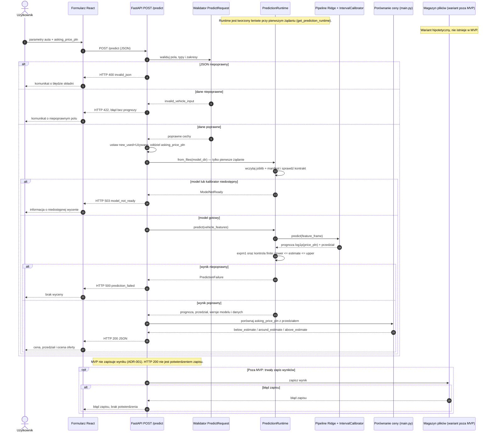

# Architektura wyceny samochodów używanych

## Zakres i granice systemu

Projekt docelowo jest aplikacją webową: użytkownik korzysta z formularza React, a backend FastAPI udostępnia prognozę przez `POST /predict`. API i walidacja żądania są już zaimplementowane. Formularz React, wytrenowany model i kalibrator przedziału nadal są planowane; bez zgodnego artefaktu poprawne żądanie otrzymuje `503 model_not_ready`.

Otomoto/OLX jest źródłem migawki danych wykorzystywanej offline. Aplikacja nie odpytuje portalu podczas wyceny. Własny system obejmuje interfejs webowy, walidację żądania, usługę predykcji, artefakt modelu oraz odpowiedź API. Baza danych i historia pojedynczych wycen nie należą do zakresu MVP.

Model danych jest opisany osobno: [model logiczny](data-model.md), [model fizyczny — schemat plików](data-model-physical.md) i [kod ERD](diagrams/data-model-erd.mmd). ERD jest logiczny, nie jest schematem bazy.

| Element | Status | Odpowiedzialność |
|---|---|---|
| `scripts/prepare_data.py` | istnieje — Lab 3 | Czyści CSV, filtruje niepoprawne rekordy, ujednolica typy i zapisuje plik przetworzony. |
| `scripts/quality_checks.py` | istnieje — Lab 3 | Sprawdza plik przetworzony: wymagane kolumny, typy, zakresy, format daty, klucze i flagi. Nie sprawdza ciągłości ani kolejności chronologicznej. |
| `scripts/compare_methods.py` i `results/lab4/` | istnieją — Lab 4 | Porównują baseline z Ridge na podziale train/test i zapisują metryki oraz obserwacje testowe. Skrypt nie zapisuje modelu do późniejszej predykcji. |
| Trening pełnego modelu i manifest | planowane | Trenuje model na pełnym przetworzonym zbiorze wyłącznie dla `new_used = Używane`; zapisuje artefakt i jego metadane. |
| `app/main.py`, `app/schemas.py` | istnieją — szkielet Lab 5 | `POST /predict`, walidacja pól, porównanie ceny z przedziałem oraz odpowiedzi 400/422/500/503. Sukces wymaga zgodnego artefaktu modelu. |
| `app/runtime.py` | istnieje — kontrakt integracyjny | Wczytuje i sprawdza artefakt joblib/manifest oraz wykonuje predykcję punktową i żąda przedziału od kalibratora. Zgodny artefakt i kalibrator nie są jeszcze dostępne. |
| Formularz React | planowany | Zbiera dane auta i cenę oferty, pokazuje prognozę, przedział oraz ocenę ceny. |

Pełny eksport `data/full-2026-11-01.csv` ma 233 040 rekordów. `data/processed/sample-clean.csv` ma 25 rekordów i służy do testów technicznych. W README opisano wynik przetworzenia pełnego eksportu (228 318 rekordów), ale pełny plik przetworzony nie znajduje się obecnie w repozytorium. Model z próbki 25 rekordów nie jest artefaktem produkcyjnym.

## UC-01 — uzyskanie wyceny i ocena ceny oferty

| Element | Opis |
|---|---|
| Cel i wymaganie | Kupujący lub sprzedający chce poznać orientacyjną cenę używanego samochodu i ocenić, czy cena z ogłoszenia jest poniżej, w granicach czy powyżej prognozowanego przedziału. Spełnia cel R1 i R3; przedział z R2 jest potrzebny do jednoznacznej interpretacji „w okolicach”. |
| Wejście | Parametry pojazdu: `make`, `model`, `year`, `mileage_km`; opcjonalnie `engine_cc`, `engine_power_km`, `fuel_type`, `gearbox`, `transmission`, `body_type`, `region`; `asking_price_pln` — cena ofertowa w PLN. Dla tego przypadku `new_used` ma stałą wartość `Używane`. |
| Warunek rozpoczęcia | Dostępny i zgodny ze schematem artefakt modelu wytrenowanego na pełnym zbiorze używanych aut oraz skalibrowany przedział niepewności. Użytkownik przekazuje poprawne parametry i dodatnią cenę ofertową. |
| Przebieg | React wysyła żądanie JSON do `POST /predict` → FastAPI waliduje składnię i typy → usługa predykcji przygotowuje cechy i wylicza cenę → moduł przedziału wyznacza granice niepewności → moduł porównania zestawia `asking_price_pln` z przedziałem → API zwraca wynik. |
| Wynik | Prognozowana cena (`estimated_price_pln`), przedział (`prediction_interval_pln.lower`, `prediction_interval_pln.upper`), ocena `below_estimate` / `around_estimate` / `above_estimate`, waluta PLN, identyfikator metody oraz wersje modelu i danych. |
| Brak danych | Brak lub niepoprawna wartość wymaganego pola kończy żądanie błędem `422`; system nie wylicza ani nie pokazuje pozornej prognozy `0`. Brak lub niezgodność modelu albo brak kalibratora kończy żądanie błędem `503`. |
| Kryterium odbioru | Dla poprawnego żądania API w czasie zgodnym z R1 zwraca skończoną dodatnią prognozę i granice przedziału w PLN, a ocena jest zgodna z porównaniem ceny ofertowej z przedziałem. Niepoprawne żądanie zwraca opis błędu bez prognozy. Test znanej próbki daje wynik odtwarzalny dla tej samej wersji artefaktu. |

### Reguła R3

Ocena ceny wynika z przedziału R2:

- `asking_price_pln < lower_pln` → `below_estimate`;
- `lower_pln <= asking_price_pln <= upper_pln` → `around_estimate`;
- `asking_price_pln > upper_pln` → `above_estimate`.

Metoda kalibracji i nominalny poziom pokrycia przedziału nie są jeszcze zaimplementowane ani ustalone. Do czasu walidacji tej metody API nie może deklarować, że R2 i R3 są spełnione. Wyniki Lab 4 są punktowe i pochodzą z próbki 25 rekordów; MAPE Ridge wynosiło 33,35% i 25,84%, więc próg ok. 15% z R6 nie został osiągnięty.

## Odpowiedzialności modułów

| Moduł | Status | Odpowiedzialność i błędy |
|---|---|---|
| Formularz React | planowany | Zbiera parametry auta i cenę oferty; pokazuje odpowiedź lub komunikat walidacji/API. Nie oblicza prognozy. |
| FastAPI `POST /predict` | istnieje — model integration pending | Weryfikuje JSON/Pydantic, wywołuje runtime, mapuje błędy na HTTP i nie zwraca ceny zastępczej. |
| Walidator `PredictRequest` | istnieje | Sprawdza wymagane pola, typy, zakresy, dodatkowe pola i cenę ofertową. `new_used` jest ustawiane serwerowo na `Używane`. |
| `PredictionRuntime.from_files` | istnieje — kontrakt artefaktu | Wczytuje pipeline i manifest; sprawdza wymagane pola manifestu, `scope="Używane"`, `target_transform="log1p"`, dokładną kolejność `features`, niepuste identyfikatory, `interval_coverage` w `(0,1)` oraz obecność pipeline'u i kalibratora. Nie wymaga `schema_version`, `trained_at` ani typów cech — to metadane opcjonalne. Brak lub niezgodność oznacza `model_not_ready`. |
| `PredictionRuntime.predict` | istnieje — oczekuje artefaktu | Wykonuje pipeline `log1p`/`expm1`, pobiera granice od kalibratora i sprawdza skończoność oraz kolejność granic. Nie sprawdza kolejności dat. |
| `IntervalCalibrator` | kontrakt określony, implementacja brak | Artefakt musi udostępniać `predict_interval(point_prediction_pln, feature_frame)`. Metoda i poziom pokrycia wymagają implementacji i walidacji na pełnym zbiorze. |
| Porównanie ceny z przedziałem | istnieje w endpointcie | Mapuje cenę ofertową na `below_estimate`, `around_estimate` lub `above_estimate`. |
| `prepare_data.py`, `quality_checks.py` | istnieją — offline | Przygotowują i kontrolują zbiory treningowe. Obecna kontrola `created_at` sprawdza format ISO 8601, nie ciągłość ani sortowanie chronologiczne. |
| `compare_methods.py` | istnieje — offline | Ewaluacja baseline/Ridge z losowym podziałem train/test; nie jest endpointem ani modułem prognozującym dla użytkownika. |

UC-01 dotyczy pojedynczego samochodu, nie szeregu czasowego, więc nie wymaga ciągłości ani kolejności dat. Jeśli późniejszy trening będzie korzystał z podziału czasowego lub wielu migawek, kontrolę zakresów i porządku dat należy dodać do walidatora danych treningowych, a nie do predyktora.

## Kontrakt interfejsu

### Żądanie

`POST /predict`, `Content-Type: application/json`.

| Pole | Typ | Jednostka / reguła |
|---|---|---|
| `make` | string | Wymagane, niepuste. |
| `model` | string | Wymagane, niepuste. |
| `year` | integer | Wymagane; rok produkcji 1950–2027 dla migawki 2026. |
| `mileage_km` | integer | Wymagane; km, 0–2 000 000. |
| `engine_cc` | integer lub null | Opcjonalne; cm³, gdy podano 500–8 000. |
| `engine_power_km` | integer lub null | Opcjonalne; KM, gdy podano 20–2 000. |
| `fuel_type` | string lub null | Opcjonalne; nazwa kategorii ze schematu danych. |
| `gearbox` | string lub null | Opcjonalne; `Manualna` lub `Automatyczna` zgodnie ze słownikiem danych. API przyjmuje dodatkowo `Półautomatyczna` jako wartość forward-compatible; w migawce i słowniku jej nie ma, więc wymaga potwierdzenia (#11). |
| `transmission` | string lub null | Opcjonalne; nazwa kategorii napędu ze schematu danych. |
| `body_type` | string lub null | Opcjonalne; nazwa kategorii nadwozia. |
| `region` | string lub null | Opcjonalne; województwo. |
| `asking_price_pln` | number | Wymagane dla R3; cena ofertowa 1 000–5 000 000 PLN. |

Usługa ustawia `new_used = "Używane"`; klient nie może wywołać tego przypadku dla `Nowość`. Brakujące opcjonalne cechy są przekazywane jako braki do imputera zapisanego w pipeline. Kategorie spoza słownika mogą być obsłużone przez `OneHotEncoder(handle_unknown="ignore")`, ale niepoprawny typ lub zakres powoduje błąd walidacji.

Zakresy w tabeli dotyczą danych **po czyszczeniu** (`prepare_data.py`), a nie surowej migawki. W surowym eksporcie mogą wystąpić starsze roczniki i niższe ceny; walidator API odrzuca je zgodnie z kontraktem po filtrze. To samo ograniczenie dotyczy `quality_checks.py`.

### Sukces i błędy

Przykładowa odpowiedź HTTP 200:

```json
{
  "estimated_price_pln": 62500.0,
  "prediction_interval_pln": {"lower": 57000.0, "upper": 69000.0},
  "asking_price_pln": 64000.0,
  "comparison": "around_estimate",
  "currency": "PLN",
  "method": "ridge_log_linear",
  "model_version": "ridge-used-v1",
  "data_version": "otomoto-2026-11-01"
}
```

Przykładowe błędy: `400 invalid_json` dla niepoprawnej składni JSON; `422 invalid_vehicle_input` dla braku, typu lub zakresu pola; `503 model_not_ready` dla brakującego, niezgodnego lub niekompletnego artefaktu; `500 prediction_failed` dla nieskończonego, nieliczbowego lub niedodatniego wyniku. Odpowiedź błędu zawiera `error` i opis pola/przyczyny, ale nie zawiera ceny.

## Model danych i zapis fizyczny

| Obiekt | Pola / znaczenie | Zapis |
|---|---|---|
| `PredictRequest` | Cechy auta zgodne z tabelą żądania oraz `asking_price_pln`; `new_used` ustawione przez serwer na `Używane`. | JSON żądania HTTP; pojedyncza obserwacja wejściowa. |
| `PredictResponse` | `estimated_price_pln`, granice przedziału, `asking_price_pln`, etykieta R3, waluta, metoda i wersje artefaktów. | JSON odpowiedzi HTTP; nie jest zapisywany jako historia w MVP. |
| `ModelBundle` | Wytrenowany preprocessing + Ridge oraz kalibrator przedziału. | Planowany `models/price-ridge.joblib`. |
| `ModelManifest` | `model_version`, `data_version`, `method`, `target_transform="log1p"`, uporządkowana lista `features`, `scope="Używane"`, `interval_method`, `interval_coverage`. Opcjonalne metadane: `trained_at`, `training_rows`, `input_sha256`, `source_file`, `snapshot_date`, `row_count`, `column_count`, `code_commit`. | Planowany `models/manifest.json`. |
| Wyniki ewaluacji | Metryki baseline/Ridge i obserwacje testowe Lab 4. | Istniejące CSV w `results/lab4/`; nie są wynikami użytkownika ani artefaktem modelu. |

Kontrakt artefaktu dla API: plik joblib zawiera mapę z obiektami `pipeline` i `interval_calibrator`. `pipeline.predict(feature_frame)` zwraca prognozę w skali `log1p(price_pln)`; API przekształca ją przez `expm1`. Kalibrator udostępnia `predict_interval(point_prediction_pln, feature_frame) -> (lower_pln, upper_pln)`. Manifest zawiera wymagane przez runtime pola: `model_version`, `data_version`, `method`, `target_transform="log1p"`, `features`, `scope="Używane"`, `interval_method` i `interval_coverage` w `(0,1)`. Brak któregokolwiek z nich oznacza `503 model_not_ready`. Pola `schema_version`, `trained_at`, `training_rows`, `input_sha256`, `source_file`, `snapshot_date`, `row_count`, `column_count` i `code_commit` są opcjonalne; obecny runtime ich nie wymaga (#11).

Pola cech w modelu muszą zachować nazwy ze słownika i **kolejność `MODEL_FEATURES`** z `app/runtime.py`: `year`, `mileage_km`, `engine_cc`, `engine_power_km`, `make`, `model`, `fuel_type`, `gearbox`, `transmission`, `body_type`, `new_used`, `region`. Kolejność jest częścią kontraktu, bo runtime porównuje listę z manifestem. `price_pln` jest celem uczenia; dla żądania R3 oddzielna nazwa `asking_price_pln` zapobiega pomyleniu ceny oferty z celem modelu. W obecnym skrypcie Ridge `city` nie jest predyktorem.

## Diagram granic i przepływu danych

Diagram jest edytowalny jako Mermaid w tym pliku. Prostokąt oznacza własne rozwiązanie; Otomoto jest wyłącznie źródłem danych offline.

```mermaid
flowchart LR
    User["Kupujący / sprzedający"]
    Otomoto["Otomoto / OLX<br/>źródło migawek"]

    subgraph Offline["Własny system — przygotowanie i ewaluacja offline"]
        Raw["data/full-2026-11-01.csv"]
        Prep["prepare_data.py<br/>ISTNIEJE"]
        Checks["quality_checks.py<br/>ISTNIEJE"]
        Clean["data/processed/*.csv"]
        Compare["compare_methods.py<br/>ISTNIEJE"]
        Lab4["results/lab4/*.csv<br/>ISTNIEJE"]
        Train["Trening pełnego modelu<br/>PLANOWANY"]
        Bundle["price-ridge.joblib<br/>manifest.json<br/>PLANOWANE"]
        Raw -->|"CSV: ogłoszenia źródłowe"| Prep
        Prep -->|"CSV: rekordy przetworzone"| Checks
        Checks -->|"CSV po PASS"| Clean
        Clean -->|"CSV do ewaluacji"| Compare
        Compare -->|"metryki i błędy testowe CSV"| Lab4
        Clean -->|"pełne dane tylko Używane"| Train
        Train -->|"pipeline + metadane wersji"| Bundle
    end

    subgraph Web["Własny system — aplikacja webowa, PLANOWANA"]
        UI["React: formularz i wynik"]
        API["FastAPI: POST /predict"]
        Validator["Walidator PredictRequest"]
        Runtime["PredictionRuntime"]
        Estimator["Pipeline Ridge<br/>PLANOWANY"]
        Interval["IntervalCalibrator<br/>PLANOWANY"]
        Comparator["Porównanie ceny<br/>w endpointcie"]
        UI -->|"JSON: parametry auta + asking_price_pln"| API
        API -->|"żądanie"| Validator
        Validator -->|"poprawne cechy, new_used=Używane"| Runtime
        Bundle -->|"joblib + manifest"| Runtime
        Runtime -->|"cechy modelu"| Estimator
        Estimator -->|"prognoza punktowa"| Interval
        Interval -->|"przedział"| Runtime
        Runtime -->|"prognoza, przedział, wersje"| API
        API -->|"asking_price_pln + przedział"| Comparator
        Comparator -->|"etykieta R3"| API
        API -->|"JSON: prognoza albo błąd HTTP"| UI
    end

    Otomoto -.->|"eksport migawki; poza runtime"| Raw
    User -->|"parametry auta i cena oferty"| UI
    UI -->|"wycena i ocena oferty"| User
```



## Przepływ i sekwencja

### Diagram sekwencji UC-01

Źródło: [`docs/diagrams/sequence.mmd`](diagrams/sequence.mmd).



Komunikaty wymagające kontraktu interfejsu: `POST /predict` i pola żądania, ustawienie `new_used="Używane"` po stronie API, pola odpowiedzi `estimated_price_pln`, `prediction_interval_pln`, `asking_price_pln`, `comparison`, `currency`, `method`, `model_version`, `data_version` oraz kody `400`, `422`, `503`, `500`. Zapis jest poza MVP (ADR-001); blok `opt` pokazuje wyłącznie wymaganą reakcję, gdyby historia wycen została dodana.

### Przepływ danych

Źródło: [`docs/diagrams/dataflow.mmd`](diagrams/dataflow.mmd). To schemat przepływu danych, a nie formalny DFD ani diagram sekwencji.

```mermaid
flowchart LR
    User["Użytkownik"]
    Otomoto["Otomoto / OLX<br/>źródło migawki"]

    subgraph Offline["Offline — przygotowanie danych i modelu"]
        Raw["data/full-2026-11-01.csv<br/>ISTNIEJE: 233 040 rekordów, 103 kolumny"]
        Prep["prepare_data.py<br/>ISTNIEJE"]
        Checks["quality_checks.py<br/>ISTNIEJE"]
        Clean["data/processed/*.csv<br/>ISTNIEJE: 25 rekordów; pełny plik PLANOWANY"]
        Train["Trening pełnego modelu<br/>PLANOWANY"]
        Bundle["price-ridge.joblib + manifest.json<br/>PLANOWANE"]
        Compare["compare_methods.py<br/>ISTNIEJE"]
        Lab4["results/lab4/*.csv<br/>ISTNIEJE"]
    end

    subgraph Online["Online — pojedyncza wycena w API"]
        UI["Formularz React<br/>PLANOWANY"]
        API["FastAPI POST /predict<br/>ISTNIEJE"]
        Validator["Walidator PredictRequest<br/>ISTNIEJE"]
        Runtime["PredictionRuntime<br/>ISTNIEJE — czeka na artefakt"]
        Pipeline["Pipeline Ridge<br/>PLANOWANY"]
        Calibrator["IntervalCalibrator<br/>PLANOWANY"]
        Comparator["Porównanie ceny<br/>ISTNIEJE w endpointcie"]
        NoStore["Brak zapisu w MVP<br/>ADR-001"]
    end

    Otomoto -.->|"eksport CSV: 103 kolumny"| Raw
    Raw -->|"CSV: id, created_at, make, model, ..., price_pln, new_used"| Prep
    Prep -->|"CSV: 81 kolumn, 0 braków"| Checks
    Checks -->|"CSV po PASS"| Clean
    Clean -->|"CSV: tylko new_used=Używane"| Train
    Train -->|"joblib + JSON: manifest z wersjami i cechami"| Bundle
    Clean -->|"CSV: 25 rekordów, podział 80/20 lub 70/30"| Compare
    Compare -->|"CSV: comparison.csv i observations.csv"| Lab4
    User -->|"parametry auta i asking_price_pln"| UI
    UI -->|"JSON: make, model, year, mileage_km, ..., asking_price_pln"| API
    API -->|"JSON"| Validator
    Validator -->|"poprawne cechy"| API
    API -->|"cechy + new_used=Używane"| Runtime
    Bundle -->|"joblib + manifest"| Runtime
    Runtime -->|"DataFrame cech"| Pipeline
    Pipeline -->|"prognoza punktowa w PLN"| Calibrator
    Calibrator -->|"lower_pln, upper_pln"| Runtime
    Runtime -->|"prognoza, przedział, wersje"| API
    API -->|"asking_price_pln + przedział"| Comparator
    Comparator -->|"below_estimate / around_estimate / above_estimate"| API
    API -->|"JSON: prognoza, przedział, etykieta, wersje"| UI
    UI -->|"cena, przedział i ocena oferty"| User
    API -.->|"brak zapisu"| NoStore
    Lab4 -.->|"raport ewaluacji"| User
```



Formaty na strzałkach: CSV źródłowy ma 103 kolumny (`id`, `created_at`, `make`, `model`, ..., `price_pln`, `new_used`), plik po przetworzeniu ma 81 kolumn i 0 braków, a żądanie i odpowiedź API są w JSON. Model ma być trenowany wyłącznie na `new_used = "Używane"`.

Świeżość danych: odbiorca API poznaje datę migawki z `data_version` w odpowiedzi i manifeście (np. `otomoto-2026-11-01`), a wersję modelu z `model_version`. Data pliku źródłowego jest też w nazwie `full-2026-11-01.csv`. Pliki `results/lab4/*.csv` nie zawierają obecnie `data_version` ani `generated_at`, więc odbiorca raportu nie zna daty odświeżenia — to luka opisana w zgłoszeniu implementacyjnym.

### Zgłoszenia implementacyjne

Zgłoszenia dla elementów przetwarzania, modelu danych i walidacji. Pełny indeks z kryteriami odbioru znajduje się w [`docs/issues/data-model.md`](issues/data-model.md).

| Issue | Zakres | Osoba |
|---|---|---|
| [#6](https://github.com/kollekka/Marabuty/issues/6) | Pełny przetworzony zbiór i wersjonowanie migawki | kollekka (Adrian Świeca) |
| [#7](https://github.com/kollekka/Marabuty/issues/7) | Walidator danych treningowych | MrKabas (Kacper Stopa) |
| [#8](https://github.com/kollekka/Marabuty/issues/8) | Metadane świeżości i wersjonowanie wyników | MrKabas (Kacper Stopa) |
| [#9](https://github.com/kollekka/Marabuty/issues/9) | Przegląd UC-01 i kontraktu (F1–F6) | kollekka (Adrian Świeca) |
| [#11](https://github.com/kollekka/Marabuty/issues/11) | Walidacja manifestu i plików wynikowych | MrKabas (Kacper Stopa) |

Elementy już istniejące (`prepare_data.py`, `quality_checks.py`, `compare_methods.py`, `results/lab4/`, `app/main.py`, `app/schemas.py`, `app/runtime.py`, ADR-001) nie mają osobnych zgłoszeń. Trening, kalibrator, integracja API i formularz są już objęte zgłoszeniami #1–#5.

Przegląd pracy A (B4) i przegląd C5: [#9](https://github.com/kollekka/Marabuty/issues/9) oraz [`docs/reviews/uc-01.md`](reviews/uc-01.md). Zgłoszenia #10 i #12 zostały zamknięte jako duplikaty odpowiednio #8 i #9.

## Spójność z Lab 3–4 — przegląd A5

- Nazwy cech i jednostki w żądaniu pochodzą ze słownika danych: przebieg w km, pojemność w cm³, moc w KM, rok jako liczba całkowita. `price_pln` pozostaje celem, a wejściowa cena ofertowa ma osobną nazwę `asking_price_pln`.
- Ridge w `scripts/compare_methods.py` używa czterech cech liczbowych oraz `make`, `model`, `fuel_type`, `gearbox`, `transmission`, `body_type`, `new_used` i `region`. Nie używa `city`; architektura również go nie deklaruje jako wejścia UC-01.
- Zbiór i UC-01 są ograniczone do aut `Używane`. Obecny preprocessing nie filtruje `new_used`, dlatego przyszły trening pełnego artefaktu musi jawnie zastosować ten filtr. Wyników Lab 4 z próbki nie należy przedstawiać jako wyniku modelu trenowanego tylko na autach używanych.
- Lab 4 zwraca prognozę punktową; nie zawiera kalibracji przedziału. R2/R3 pozostają niegotowe do implementacji produkcyjnej, dopóki metoda i pokrycie przedziału nie zostaną wybrane oraz ocenione na pełnych danych.
- Wymaganie R4 mówi o co najmniej trzech porównanych metodach i rankingu cech; obecne wyniki Lab 4 obejmują baseline i Ridge, bez rankingu ważności. Rozszerzenie jest zadaniem do implementacji, nie istniejącym elementem.
- Obecne `quality_checks.py` sprawdza format `created_at`, nie ciągłość ani kolejność. Dla pojedynczego wejścia samochodu nie jest to potrzebne; ewentualna kontrola chronologii należy do walidacji danych treningowych.
- R5 jest częściowo zaimplementowane: API zwraca 400/422 dla niepoprawnych żądań, ale bez zgodnego artefaktu poprawne żądanie kończy się 503, a nie prognozą. `quality_checks.py` nadal waliduje plik CSV, nie żądanie użytkownika.
- Obsługa brakujących lub niepoprawnych danych użytkownika należy do walidatora API. Istniejące kontrole jakości dotyczą plików CSV i nie zastępują walidacji żądania.

## Przegląd C5 — co poprawiono

Pełny zapis przeglądu: [`docs/reviews/uc-01.md`](reviews/uc-01.md). Najważniejsze poprawki w tym dokumencie:

- ujednolicono nazwy `PredictRequest` / `PredictResponse` / `PredictionRuntime`; usunięto `VehicleInput`, `PredictionService`, `ModelBundleLoader` i `OfferComparator` jako osobne klasy;
- podano kanoniczną kolejność `MODEL_FEATURES` i wyjaśniono, że jest częścią kontraktu manifestu;
- rozdzielono wymagane pola manifestu od opcjonalnych metadanych (`schema_version`, `trained_at`, typy cech nie są wymagane przez runtime);
- opisano leniwe wczytywanie runtime przy pierwszym żądaniu, zgodnie z `app/main.py`;
- dopisano, że zakresy walidacji dotyczą danych po czyszczeniu, a `Półautomatyczna` jest wartością spoza migawki;
- pozostawiono jawne ścieżki `400 invalid_json`, `422 invalid_vehicle_input`, `503 model_not_ready` i `500 prediction_failed` w sekwencji;
- potwierdzono, że UC-01 nie zapisuje wyniku i nie ma ścieżki błędu zapisu; ewentualny zapis wymaga osobnego kontraktu (ADR-001).
