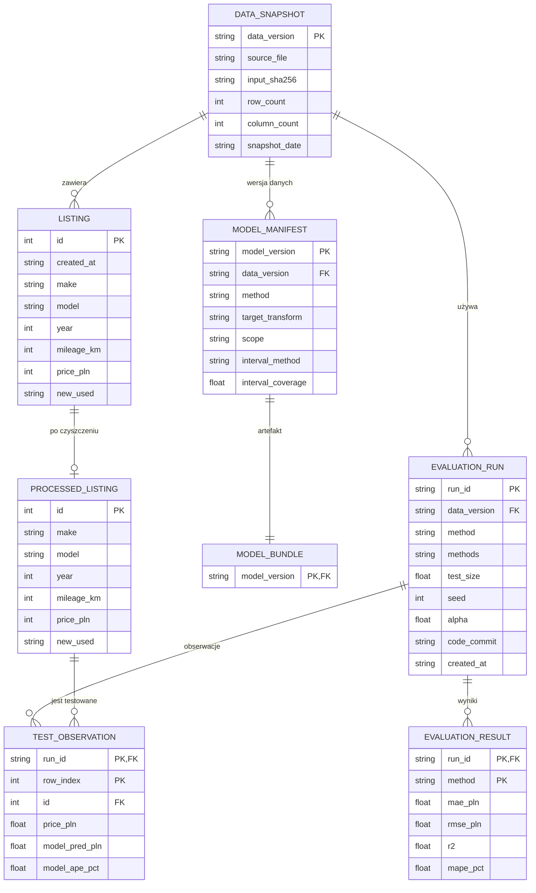

# Model logiczny danych

## Cel i zakres

Dokument opisuje model logiczny dla **UC-01 — uzyskanie wyceny i ocena ceny oferty** oraz dla artefaktów offline z Lab 3–4. Nazwy pól pochodzą z [słownika danych](data-dictionary.md). Model logiczny nie jest schematem bazy: MVP nie ma bazy danych (patrz [ADR-001](decisions/001-storage.md)), a konkretny zapis plików opisuje [model fizyczny](data-model-physical.md).

Model obejmuje dwa rodzaje obiektów:

- **trwałe zbiory i artefakty** — migawka danych, rekordy ogłoszeń, manifest i artefakt modelu oraz wyniki ewaluacji,
- **obiekty nietrwałe** — żądanie i odpowiedź API, które w MVP nie są zapisywane jako historia.

## Obiekty i zbiory

| Obiekt | Co oznacza jeden rekord | Klucz | Trwałość | Nośnik |
|---|---|---|---|---|
| `DataSnapshot` | Jedna wersja migawki danych źródłowych. | `data_version` | metadane | manifest / `run.json` |
| `Listing` | Jedno ogłoszenie samochodu z migawki Otomoto. | `id` | trwały | `data/full-2026-11-01.csv`, `data/raw/sample.csv` |
| `ProcessedListing` | Jeden oczyszczony wiersz ogłoszenia, bez nowych pól. | `id` | trwały, odtwarzalny | `data/processed/sample-clean.csv` |
| `ModelManifest` | Jedna wersja modelu i danych treningowych. | `model_version` | trwały | `models/manifest.json` |
| `ModelBundle` | Jeden artefakt modelu: pipeline i kalibrator przedziału. | `model_version` | trwały | `models/price-ridge.joblib` |
| `EvaluationRun` | Jedno uruchomienie analizy porównawczej. | `run_id` | docelowo trwały | `results/runs/<data_version>/<run_id>/run.json` |
| `EvaluationResult` | Wynik jednej metody w jednym uruchomieniu. | `(run_id, method)` | trwały | `results/lab4/comparison.csv` |
| `TestObservation` | Jedna obserwacja testowa w jednym uruchomieniu. | `(run_id, row_index)` | trwały | `results/lab4/observations.csv` |
| `PredictRequest` | Jedno żądanie wyceny z `POST /predict`. | brak | nietrwały | JSON żądania HTTP |
| `PredictResponse` | Jedna odpowiedź wyceny z `POST /predict`. | brak | nietrwały | JSON odpowiedzi HTTP |

## Znaczenie pojedynczego rekordu

- **`Listing`** — jeden wiersz to jedno ogłoszenie. `id` jest unikalnym identyfikatorem ogłoszenia. `price_pln` jest ceną ofertową, a nie transakcyjną. Wartość `0` w flagach `has_*` i polach stanu oznacza „nie zadeklarowano w ogłoszeniu”, a nie „pojazd tego nie ma”. Pełny zestaw 103 kolumn opisuje słownik danych.
- **`ProcessedListing`** — jeden wiersz to to samo ogłoszenie po czyszczeniu. Wynik ma 81 kolumn i nie dodaje pól pochodnych. Relacja z `Listing` jest 1:0..1, bo czyszczenie może odrzucić cały rekord.
- **`DataSnapshot`** — jeden rekord opisuje jedną migawkę: `data_version`, plik źródłowy, SHA256, liczbę wierszy i kolumn oraz datę migawki. To metadana wersji, nie tabela z ogłoszeniami. W MVP nie ma osobnego pliku migawki-metadanych: `data_version` i data wynikają z nazwy pliku oraz README, a `input_sha256`, `source_file`, `snapshot_date`, `row_count` i `column_count` są opcjonalnymi polami manifestu opisanymi w [modelu fizycznym](data-model-physical.md).
- **`ModelManifest`** — jeden rekord opisuje jedną wersję modelu: `model_version`, `data_version`, metodę, transformację celu, uporządkowaną listę cech, zakres `Używane` oraz metodę i pokrycie przedziału. Opcjonalnie może zawierać `trained_at`, `training_rows`, `input_sha256`, `source_file`, `snapshot_date`, `row_count`, `column_count` i `code_commit`.
- **`ModelBundle`** — jeden artefakt joblib zawiera mapę z `pipeline` i `interval_calibrator`. Jest w relacji 1:1 z manifestem.
- **`EvaluationRun`** — jedno uruchomienie `scripts/compare_methods.py`: `run_id`, `data_version`, `method` (metoda główna), `methods` (lista porównywanych metod), `test_size`, `seed`, `alpha`, `code_commit`, `created_at` i ścieżki wyników.
- **`EvaluationResult`** — jeden wiersz to wynik jednej metody (`baseline` albo `ridge`) w danym runie. Zawiera `mae_pln`, `rmse_pln`, `r2` i `mape_pct`.
- **`TestObservation`** — jeden wiersz to jedna obserwacja testowa w danym runie: rzeczywista cena, prognozy, błędy bezwzględne i APE.
- **`PredictRequest`** — jedno żądanie API z parametrami auta i `asking_price_pln`; nie jest zapisywane.
- **`PredictResponse`** — jedna odpowiedź API z prognozą, przedziałem, etykietą R3, walutą, metodą i wersjami; nie jest zapisywana.

## Powiązania

| Relacja | Kardynalność | Znaczenie |
|---|---|---|
| `DataSnapshot` → `Listing` | 1:N | Migawka zawiera wiele ogłoszeń. |
| `Listing` → `ProcessedListing` | 1:0..1 | Oczyszczony wiersz istnieje tylko dla rekordów, które przeszły czyszczenie. |
| `DataSnapshot` → `ModelManifest` | 1:N | Kolejne wersje modelu mogą używać tej samej migawki. |
| `ModelManifest` → `ModelBundle` | 1:1 | Każdy manifest opisuje dokładnie jeden artefakt joblib. |
| `DataSnapshot` → `EvaluationRun` | 1:N | Ten sam zbiór może być użyty w wielu uruchomieniach. |
| `EvaluationRun` → `EvaluationResult` | 1:N | Jeden run ma wynik dla każdej porównywanej metody. |
| `EvaluationRun` → `TestObservation` | 1:N | Jeden run ma wiele obserwacji testowych. |
| `ProcessedListing` → `TestObservation` | 1:N | Ten sam wiersz może być testowany w różnych runach. |
| `ModelManifest` → `PredictRequest` / `PredictResponse` | 1:N | Żądanie i odpowiedź wskazują wersję modelu i danych, ale nie są utrwalane. |

## Diagram ERD — model logiczny

> **Ważne:** to ERD logiczny, a nie schemat fizyczny bazy. MVP nie ma bazy danych, więc nie należy traktować tego diagramu jako DDL ani tworzyć na jego podstawie fikcyjnej bazy. Fizyczny zapis to pliki opisane w [modelu fizycznym](data-model-physical.md).

Kod do wklejenia w Mermaid Live Editor znajduje się też w pliku [`docs/diagrams/data-model-erd.mmd`](diagrams/data-model-erd.mmd).

W diagramie pokazano pola kluczowe i pola modelu. Pełną listę 103 kolumn źródłowych i 81 kolumn wyniku zawiera [słownik danych](data-dictionary.md).

Uwagi do ERD:

- `data_version` **nie jest kolumną** plików CSV. Przynależność wierszy do migawki wynika z nazwy i pochodzenia pliku oraz z metadanych w manifeście/`run.json`. Dlatego `LISTING` i `PROCESSED_LISTING` nie mają atrybutu `data_version`, a relacja z `DATA_SNAPSHOT` jest logiczna.
- W plikach `comparison.csv` i `observations.csv` klucz jest lokalny: `(split, method)` oraz `(split, row_index)`. Klucz logiczny `(run_id, method)` i `(run_id, row_index)` wynika z katalogu runu, bo pliki Lab 4 nie zawierają `run_id`.
- `MODEL_BUNDLE` nie ma własnego pliku metadanych; ścieżka artefaktu jest stała (`models/price-ridge.joblib`), a `model_version` pochodzi z manifestu.

## Nazwy pól i reguły

- `price_pln` jest **celem uczenia** i nie może być przekazywane jako cecha wejściowa.
- `asking_price_pln` jest **ceną ofertową** przekazywaną przez użytkownika; nazwa jest różna od `price_pln`, żeby nie pomylić ceny oferty z celem modelu.
- `new_used` jest ustawiane przez serwer na `Używane`; klient nie może wybrać `Nowość` w UC-01.
- Kolejność cech modelu jest zgodna z `MODEL_FEATURES` w `app/runtime.py`:
  `year`, `mileage_km`, `engine_cc`, `engine_power_km`, `make`, `model`, `fuel_type`, `gearbox`, `transmission`, `body_type`, `new_used`, `region`.
- Jednostki: `price_pln` i `asking_price_pln` w PLN, `mileage_km` w km, `engine_cc` w cm³, `engine_power_km` w KM, `year` jako rok produkcji.
- `city` nie jest predyktorem w obecnym modelu. `generation` i flagi wyposażenia nie wchodzą do pierwszego modelu z powodu braków i ryzyka przeuczenia.
- W migawce `gearbox` przyjmuje wartości `Manualna` i `Automatyczna`. API dopuszcza dodatkowo `Półautomatyczna` jako wartość forward-compatible; `OneHotEncoder(handle_unknown="ignore")` obsłuży kategorię spoza danych treningowych. Model danych **nie dodaje** tej wartości do migawki. Decyzja o usunięciu z API albo pozostawieniu należy do #9 F4 i #11; C nie zmienia `app/schemas.py`.
- `id` jest kluczem wiersza i nie jest cechą modelu. `created_at` pozostaje w danych, bo pozwala na podział czasowy w przyszłości, ale UC-01 dotyczy jednego samochodu i nie wymaga ciągłości dat.

## Mapowanie nazw logicznych na implementację

| Nazwa logiczna | Implementacja | Uwaga |
|---|---|---|
| `PredictRequest` | `app.schemas.PredictRequest` | To samo wejście UC-01; walidacja Pydantic. |
| `PredictResponse` | `app.schemas.PredictResponse` | To samo wyjście UC-01; odpowiedź HTTP 200. |
| `Listing` / `ProcessedListing` | `data/full-2026-11-01.csv`, `data/processed/sample-clean.csv` | Widoki logiczne na wiersze CSV, nie tabele bazy. |
| `ModelManifest` / `ModelBundle` | `models/manifest.json`, `models/price-ridge.joblib` | Manifest opisuje artefakt; para jest 1:1. |
| `EvaluationRun` | `results/runs/<data_version>/<run_id>/run.json` | Docelowy zapis; Lab 4 ma tylko CSV. |
| `EvaluationResult` / `TestObservation` | `comparison.csv`, `observations.csv` | Wyniki Lab 4 i przyszłych runów. |

## Czego model nie zawiera

- **`User`** — wymagania nie przewidują kont ani logowania.
- **`Seller`** — dane sprzedawcy są w migawce, ale nie są predyktorami i nie są publikowane; nie ma wymagania wielu ogłoszeń jednego sprzedawcy.
- **`PredictionHistory`** — MVP nie zapisuje historii wycen; to świadoma decyzja z ADR-001.
- **`ForecastSeries` / `target_date`** — UC-01 nie jest prognozą szeregu czasowego; dane to jedna migawka, a wynik dotyczy jednego samochodu. Opcjonalny `forecast.csv` z modelu fizycznego jest eksportem pojedynczej wyceny, a nie serią czasową ani historią.
- **Tabele bazy danych** — projekt nie ma bazy w MVP; model fizyczny to pliki.

## Ślad wymagań

| Wymaganie | Element modelu |
|---|---|
| R1 — szybka orientacyjna cena | `PredictRequest`, `PredictResponse` |
| R2 — przedział niepewności | `PredictResponse.prediction_interval_pln`, `ModelManifest.interval_method`, `interval_coverage` |
| R3 — ocena ceny oferty | `PredictResponse.comparison` |
| R5 — obsługa błędnych danych | walidacja `PredictRequest` w `app/schemas.py` |
| R6 — jakość modelu | `EvaluationResult` i `TestObservation` |
| R4 — ranking cech | poza obecnym modelem danych; zadanie implementacyjne, nie obiekt danych |
